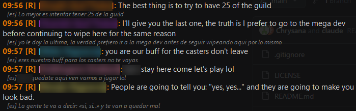

# WoW Auto Translate

A small standalone Windows app that reads the World of Warcraft chat window off your screen and shows English translations of anything written in another language, live, in a separate always-on-top window.

It is **not** an addon and doesn't touch the game: it only takes screenshots of the area you choose, runs OCR on them, and translates the text.



*Spanish raid chat translated live during a raid. Player names are blurred.*

> **Built with AI.** This project was written with [Claude Code](https://claude.com/claude-code), Anthropic's AI coding assistant. Claude wrote the code, documentation and build setup; the maintainer directed the work and tested it in live raids. Review it as you would any other code, and please report any problems you find.

## Features

- **Drag a box over your chat**: the app watches that area once a second.
- **Reads every WoW client language**: English, Spanish, Portuguese, German, French, Italian, Russian, Korean, and Chinese (simplified and traditional). Japanese works too.
- **Translates anything non-English to English**, showing the original text underneath (this can be turned off).
- **Class-coloured names**: player names are shown in their class colour, as in game.
- **Handles real chat**: joins wrapped lines, ignores half-visible lines at the edge of the box and brief overlays (tooltips, "Scroll to Bottom"), and never shows the same message twice.

## Download and run (Windows)

1. Download `WoWAutoTranslate-v<version>-windows.zip` from the [Releases](https://github.com/Chrysana/wow-auto-translate/releases) page.
2. Unzip it anywhere.
3. Double-click `WoWAutoTranslate.exe`.

You don't need to install Python, and the OCR models are included. Windows may show a "Windows protected your PC" warning because the app isn't code-signed: click **More info**, then **Run anyway**.

## Use

1. Start the app.
2. Click **Select area** and drag a box over the WoW chat window. The area is remembered for next time.
3. Move the translation window somewhere **outside** that box.
4. Set WoW to **Windowed (Fullscreen)** so the translation window can stay on top.

Right-click the text area for **Debug: show raw OCR**, which shows what the OCR reads and why lines were skipped.

## Run from source

Requires Windows and [Python 3.11+](https://www.python.org/downloads/).

```
pip install -r requirements.txt
python wow_translate.py
```

Or double-click `run.bat`. The OCR models (a few MB each) download automatically the first time you run it.

## Build the .exe

Double-click `build.bat`, or run:

```
pip install -r requirements.txt pyinstaller
python build.py
```

This creates `dist/WoWAutoTranslate/WoWAutoTranslate.exe` and a release zip in `dist/`. The zip includes the four OCR models the app uses and every bundled component's license files (in `licenses/`).

To check a build without the UI, run `WoWAutoTranslate.exe --self-test chat.png out.txt`. It reads a chat screenshot, translates it, and writes the results to `out.txt`.

## How it works

1. **Capture**: screenshots the chosen area with [mss](https://github.com/BoboTiG/python-mss).
2. **OCR**: [RapidOCR](https://github.com/RapidAI/RapidOCR) (PaddleOCR models on ONNX Runtime) finds each line. A multilingual PP-OCRv6 model reads Latin-alphabet languages, Chinese and Japanese. Separate models re-read each line for Russian (Cyrillic) and Korean, and their reading is used when it is mostly in their script. Windows' built-in OCR is the fallback if RapidOCR isn't installed.
3. **Grouping**: WoW starts each message at the left edge and indents wrapped lines, so lines are joined into messages by indentation.
4. **Filtering**: a line must read the same on two scans in a row. Chat only grows downward, so only messages below the last one already handled are treated as new.
5. **Translation**: Google Translate's free web endpoint detects the language and translates. Only WoW's client languages are translated; if detection misfires on slang or a typo, the app retries assuming the language recent chat has been in.
6. **Colours**: WoW draws text in exact colours, so pixels matching known class or channel colours show where the name is and what class it belongs to.

## Settings

The constants near the top of `wow_translate.py`:

| Setting | Default | What it does |
|---|---|---|
| `TARGET_LANG` | `"en"` | Language to translate into |
| `SCAN_SECONDS` | `1.0` | How often to scan the chat |
| `MIN_CONFIDENCE` | `0.93` | How confident the OCR must be in a line before it is used |
| `WOW_LANGS` | WoW client languages | Detected languages that get translated |

## Privacy

Each new non-English chat message is sent to Google Translate. Nothing else leaves your machine.

## License

[GPL-3.0](LICENSE). Uses RapidOCR and PaddleOCR models (Apache-2.0), mss and ONNX Runtime (MIT), Pillow (MIT-CMU), and others. See [THIRD_PARTY_NOTICES.md](THIRD_PARTY_NOTICES.md).

World of Warcraft is a trademark of Blizzard Entertainment. This project is not affiliated with or endorsed by Blizzard.
